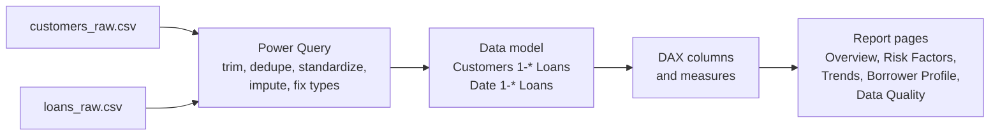

# LoanLens - Power BI Loan Default Analysis

LoanLens is a Power BI project that looks at which borrowers default on their loans and why.
The raw data is cleaned in Power Query, modelled as a star schema with DAX, and presented in an
interactive report covering risk factors, trends and borrower profiles.

Out of 49,750 loans, 11.57% defaulted. Age, interest rate, loan amount, income and length of
employment have the strongest link to default. Young, low-income borrowers on high-rate loans
default at 38.9%, compared with 1.2% for older, high-income borrowers on low rates.

## Repository layout

```
loanlens/            Python package that prepares the data
  config.py          paths, seed, sample sizes
  sampling.py        sample the Kaggle data, split into customers and loans
  corruption.py      add data quality problems for the cleaning exercise
  cleaning.py        cleaning rules (mirror of the Power Query scripts)
  bands.py           risk bands (mirror of the DAX calculated columns)
  report.py          writes expected_results.md
  pipeline.py        prepare and clean steps
  __main__.py        command line entry point
tests/               unit tests for the cleaning and banding rules
data/raw/            files loaded into Power BI
data/clean/          reference output and expected_results.md
powerquery/          M scripts for the Customers and Loans queries
dax/                 date table, calculated columns, measures
theme/               Power BI colour theme
docs/                step-by-step guides and the insights report
LoanLens.pbip        Power BI project (open this in Power BI Desktop)
LoanLens.SemanticModel/  data model as TMDL (queries, tables, relationships, measures)
LoanLens.Report/     report pages and visuals (PBIR format)
tools/build_report.py  regenerates the report pages in LoanLens.Report
```

## Getting started

### 1. Get the data

Download `Loan_default.csv` from the Kaggle
[Loan Default Prediction Dataset](https://www.kaggle.com/datasets/nikhil1e9/loan-default)
and put it in the project root. It isn't committed to the repo because of its size.

The files in `data/raw/` are already in the repo, so this step is only needed if you want to
regenerate them.

### 2. Set up Python (optional)

```bash
python -m venv .venv
.venv\Scripts\activate          # on macOS/Linux: source .venv/bin/activate
pip install -r requirements.txt
```

```bash
python -m loanlens all          # rebuild data/raw and data/clean
python -m pytest                # run the tests
```

`python -m loanlens prepare` and `python -m loanlens clean` run the two steps on their own.

### 3. Open the finished report

Open `LoanLens.pbip` (or `LoanLens.pbix`) in Power BI Desktop and click **Refresh**. If the
project folder isn't `C:\krishna\College\intership\euron_1`, change the `DataFolder`
parameter first (**Transform data > Edit parameters**).

To rebuild the pages after changing the layout, close Power BI Desktop and run
`python tools/build_report.py`.

### 4. Build it yourself

To build the report by hand, follow the guides in order:

1. [Data dictionary](docs/01_Data_Dictionary.md)
2. [Power Query cleaning](docs/02_Power_Query_Cleaning_Guide.md)
3. [Data model and DAX](docs/03_Data_Model_and_DAX_Guide.md)
4. [Dashboard build](docs/04_Dashboard_Build_Guide.md)
5. [Insights report](docs/05_Insights_Report.md)
6. [User guide](docs/06_User_Guide.md)

When you're done, compare the numbers in your report with
[data/clean/expected_results.md](data/clean/expected_results.md). They should match exactly.

## How it fits together



## Requirements coverage

| ID | Requirement | Where it's handled |
|---|---|---|
| FR1 | Import CSV/Excel data | `powerquery/`, docs/02 |
| FR2 | Handle missing values, duplicates, formats | docs/02 (19 issue types, see docs/01) |
| FR3 | Relationships, calculated columns, measures | docs/03, `dax/` |
| FR4 | Visualise key risk factors | Risk Factors page, 6 factors |
| FR5 | Default trends over time | Trends page |
| FR6 | Filter by demographics and loan attributes | Synced slicers on every page |
| FR7 | Summary statistics and insights | Overview page, docs/05 |
| FR8 | Interactive and easy to use | Drill-through, tooltips, navigation, reset button |
| NFR1 | Built in Power BI | Power BI Desktop |
| NFR2 | Processing under 5 minutes | Refresh takes a few seconds |
| NFR3 | Responsive dashboards | Checked with Performance Analyzer (docs/04) |
| NFR4 | Documentation | `docs/` |

## About the data

The source is the Kaggle Loan Default Prediction Dataset (255,347 loans). It has no missing values
or duplicates and no dates, so for this project I:

- took a random sample of 49,750 loans to stay under the 50,000 record limit,
- added a `CustomerID` so some customers have more than one loan,
- added a synthetic `IssueDate` between 2019 and 2024,
- introduced data quality problems on purpose so there is real cleaning to do.

Every change is listed in [docs/01_Data_Dictionary.md](docs/01_Data_Dictionary.md) and logged row
by row in `data/raw/data_quality_log.csv`. Because the dates are synthetic, the default rate over
time is flat and shouldn't be read as a real trend.
