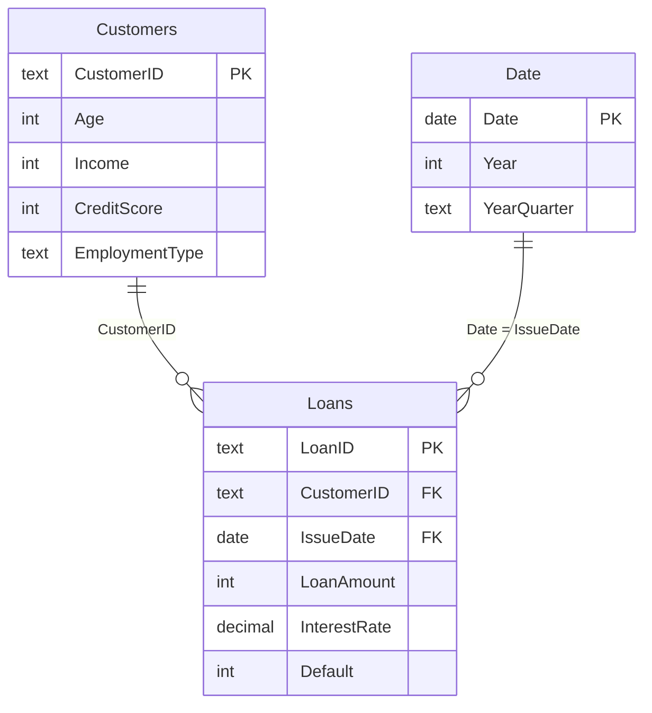

# Data Model and DAX Guide

Covers FR3 (relationships, calculated columns and measures).

## The model

A simple star schema with one fact table and two dimension tables:

- `Loans` is the fact table: one row per loan. All the measures count or sum it.
- `Customers` and `Date` are dimensions. Filters flow from them into `Loans` (single direction),
  so a slicer on `Customers[Education]` filters the loans of those customers.

## 1. Date table

1. **Modeling > New table**, paste the code from `dax/01_Date_Table.dax`.
2. **Table tools > Mark as date table**, choose the `Date` column.
3. Sort `Date[Month]` by `Month Number` and `Date[Year Quarter]` by `Year Quarter Number`
   (**Column tools > Sort by column**).

If Power BI reports a circular dependency, replace the two `VAR` lines with fixed dates:
`CALENDAR ( DATE ( 2019, 1, 1 ), DATE ( 2024, 12, 31 ) )`.

## 2. Relationships

In Model view, make sure these two relationships exist and delete any others Power BI created
automatically:

| From | To | Cardinality | Cross filter |
|---|---|---|---|
| `Customers[CustomerID]` | `Loans[CustomerID]` | One to many | Single |
| `Date[Date]` | `Loans[IssueDate]` | One to many | Single |

Drag one field onto the other to create a relationship, and double-click the line to check its
settings.

## 3. Calculated columns

The definitions are in `dax/02_Calculated_Columns.dax`. For each one:

1. Select the table (Customers or Loans) in the Data pane.
2. **Table tools > New column**, paste the definition.
3. For band columns, set **Sort by column** to the matching `Order` column.
4. Hide the `Order` columns from report view so they don't clutter the field list.

| Table | Columns |
|---|---|
| Customers | Age Group, Income Band, Credit Score Band, Employment Length (each with an Order column) |
| Loans | Interest Rate Band, Loan Amount Band, DTI Band (each with an Order column), Monthly Payment, Loan to Income, Payment to Income |

A calculated column is worked out once per row at refresh time, so it is good for things you
want to slice or group by, like Age Group. A measure is calculated on the fly for whatever is
currently filtered, which is what you want for totals and ratios like Default Rate.

## 4. Measures

1. **Home > Enter data**, call the table `_Measures` and load it. This keeps all the measures in
   one place.
2. Select `_Measures`, then **Table tools > New measure** and paste each measure from
   `dax/03_Measures.dax`.
3. Set the format noted in the comment above each measure.
4. Once there is at least one measure in the table, delete the empty `Column1`.

The most important measures:

| Measure | What it gives you | How |
|---|---|---|
| Total Loans | Number of loans | `COUNTROWS` |
| Defaulted Loans | Number of defaulted loans | `CALCULATE` with a filter on LoanStatus |
| Default Rate | Share of loans that defaulted | `DIVIDE`, which handles divide by zero |
| Overall Default Rate | Portfolio average, ignoring slicers | `REMOVEFILTERS()` |
| Risk Index | Segment rate compared with the average (1.0 = average) | Ratio of the two above |
| Defaulted Amount | Money in defaulted loans | `CALCULATE` + `SUM` |
| Avg Credit Score | Average score of the borrowers behind the loans | `AVERAGEX` + `RELATED` |
| Default Rate PY, YoY Change, vs Prior Year | Change against the previous year (vs Prior Year is the text for the card) | `SAMEPERIODLASTYEAR`, `HASONEVALUE` |
| Default Rate 12M Rolling | Smoothed trend line | `DATESINPERIOD` |
| Imputed / Unknown counts | How much data had to be repaired | Used on the Data Quality page |

## 5. Check against the expected results

Add a temporary table visual with `Customers[Age Group]`, Total Loans, Defaulted Loans and
Default Rate. It should match the Age Group table in `data/clean/expected_results.md`
(for example 18-25: 7,578 loans, 19.82%). Do the same for the KPI values, then delete the
test page.
